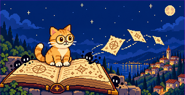
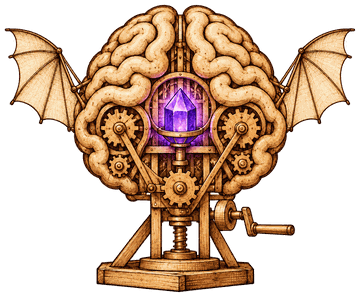
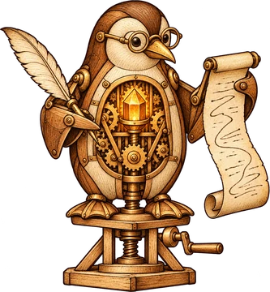
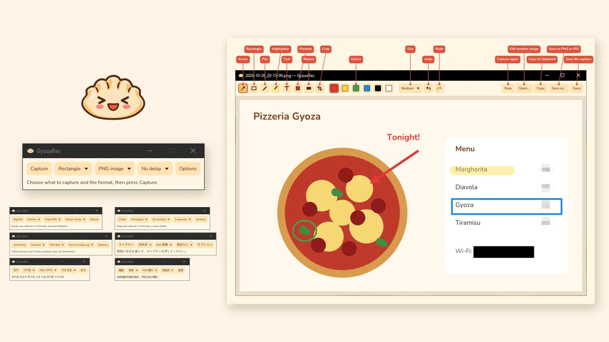
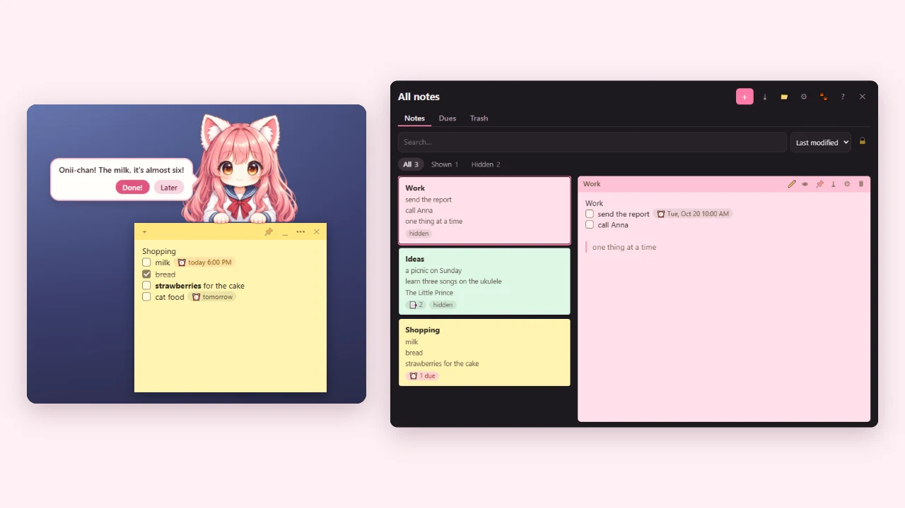
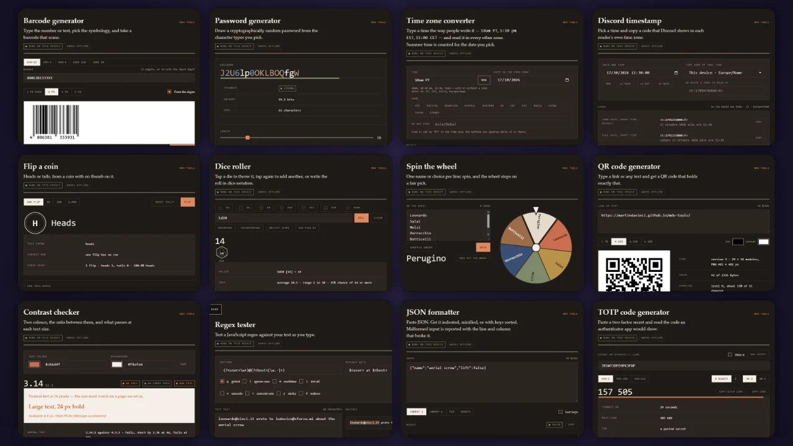
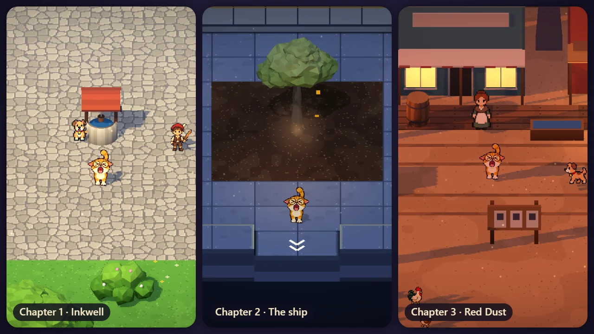
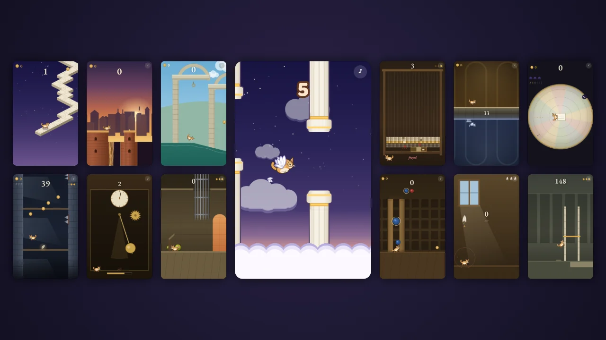
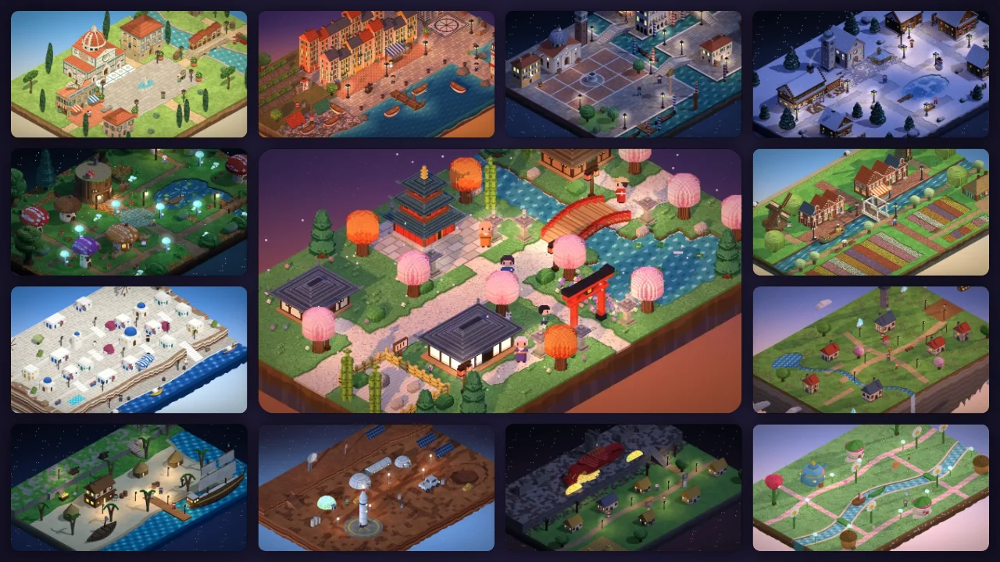
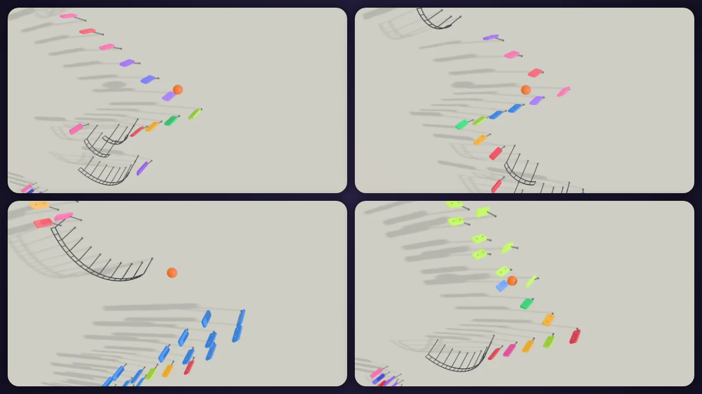

# Martin DaVinci

*Knowledge has no limits.*

## AI skills

<table>
<tr>
<td width="25%" align="center"></td>
<td width="75%" valign="top"><b><a href="https://github.com/martindavinci/mdv-second-brain">mdv-second-brain</a></b> An AI skill for Claude Code and Codex, installed as a plugin: persistent project memory for coding agents, kept as an Obsidian vault for each workspace. While you work, the agent records what was done, why and what was learned (a Kanban board, living task and issue notes, daily checkpoints, distilled project knowledge, decisions and ideas), so the next session starts where the last one stopped. It checks the vault for broken links and stale work and tells you what happened in a day or a week. Workspaces never mix, and it does nothing until you run <code>/brain init</code>.</td>
</tr>
<tr>
<td width="25%" align="center"></td>
<td width="75%" valign="top"><b><a href="https://github.com/martindavinci/mdv-linux-kernel">mdv-linux-kernel</a></b> An AI skill for Claude Code and Codex that mentors people sending their first Linux kernel patches, with netdev in depth. It does not hide AI use: it asks for evidence tied to the exact code and follows each tree's own rules. Before anything goes out, it checks the patch for the signs of AI slop that maintainers look for (a vague changelog, a wrong <code>Fixes:</code> tag, needless churn), then asks you questions about it, so you only send what you understand. You sign off and send it yourself.</td>
</tr>
</table>

## Apps

<table>
<tr>
<td width="50%"></td>
<td width="50%" valign="top"><b><a href="https://github.com/martindavinci/GyozaRec">GyozaRec</a></b> Fast, cute screen capture for Windows 10 and 11: a rectangle, a window or the full screen to PNG, JPG, MP4 or animated GIF. MP4s with system audio, recordings you can pause, an editor to mark up images, global shortcuts, 9 languages, installer or portable. Entirely local: no uploads, no accounts.</td>
</tr>
<tr>
<td width="50%"></td>
<td width="50%" valign="top"><b><a href="https://github.com/martindavinci/ImoutoNotes">Imouto Notes</a></b> Sticky notes for Windows 10 and 11 with a chibi neko imouto hanging on them, who reminds you of what is due and nags, a little more each minute, until you tick it. Notes are Markdown files edited as Obsidian's live preview shows them, with pages, pictures, dues, encrypted notes and a window with all of them. 14 languages, no network connection at all. Freeware.</td>
</tr>
</table>

## Tools

<table>
<tr>
<td width="50%"></td>
<td width="50%" valign="top"><b><a href="https://martindavinci.github.io/mdv-tools/">MDV Tools</a></b> Web tools that each do one job. Nothing leaves your device: no requests once a page has loaded, no account, works offline.</td>
</tr>
</table>

## Demos

<table>
<tr>
<td width="50%"></td>
<td width="50%" valign="top"><b><a href="https://martindavinci.github.io/mdv-demo-rpg-cat/">The Scholar Cat RPG</a></b> A small retro action-RPG: pixel-art characters in a low-poly world. Folio, the library cat, takes up a quill in four chapters: a village where ink creatures crawl out of a torn codex, a silent ship in deep space, a mining town of the old West, Longmen by the Dragon Gate on the night its lanterns go out. Between them, a card tourney against the people met along the way. Keyboard, gamepad or touch; in English and Italian.</td>
</tr>
<tr>
<td width="50%"></td>
<td width="50%" valign="top"><b><a href="https://martindavinci.github.io/mdv-demo-arcade/">The Scholar Cat Cabinet</a></b> 22+ one-button arcade games with the same cat in each. Space or tap is the only control.</td>
</tr>
<tr>
<td width="50%"></td>
<td width="50%" valign="top"><b><a href="https://martindavinci.github.io/mdv-demo-diorama/">Borghi in diorama</a></b> 30+ pixel-art villages to walk around. No 3D models: every sprite pixel is extruded into depth. In Italian.</td>
</tr>
<tr>
<td width="50%"></td>
<td width="50%" valign="top"><b><a href="https://martindavinci.github.io/mdv-demo-marble-loop/">Marble Loop</a></b> A marble bounces down xylophone keys set in a white wall and plays Mozart, Offenbach and Rossini, in a 45-second loop that never ends. Tap for sound.</td>
</tr>
</table>
